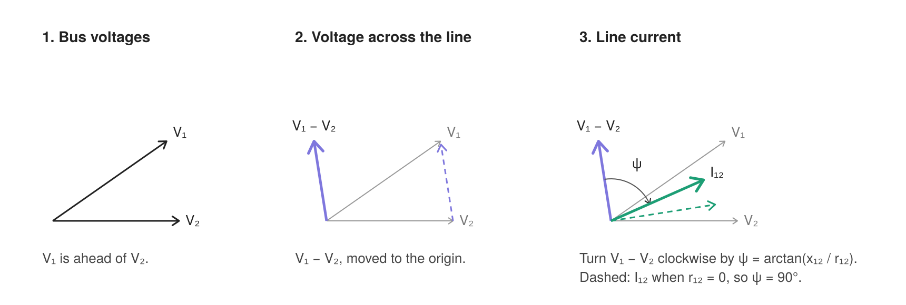

# Power flow in one page

This page is AC throughout.
It makes no small-angle assumption and no flat-voltage assumption.

**Notation.**
Bus $k$ has voltage $\mathbf{V}_k = V_k e^{j\theta_k}$, and $\theta_{km} = \theta_k - \theta_m$.
Line $km$ has impedance $r_{km} + j x_{km}$ and admittance $1/(r_{km} + j x_{km}) = g_{km} - j b_{km}$.
$\mathbf{I}_{km}$ is the current on line $km$ from bus $k$ to bus $m$.
$P_{km} + jQ_{km} = \mathbf{V}_k \mathbf{I}_{km}^*$ is the power that enters line $km$ at bus $k$.
$P_k + jQ_k$ is the power injected at bus $k$: generation minus load.
$N(k)$ is the set of buses connected to bus $k$ by a line.

## 1. Power at a point, and two angles

Power at a point depends on the angle between the voltage and the current at that point.
$\varphi$ is the angle of the voltage minus the angle of the current.

$$P = V I \cos\varphi \qquad Q = V I \sin\varphi$$

$P$ is the average rate of energy transfer.
$Q$ is the amplitude of the energy that goes out and comes back each half cycle.
$\theta_{km}$ is a different angle: the voltage at bus $k$ against the voltage at bus $m$.
A line links the two angles (section 3).

## 2. What each device fixes

Each bus has four numbers, $P_k$, $Q_k$, $V_k$, $\theta_k$, and no device fixes an angle.
A generator fixes $P_k$ with its valve and $V_k$ with its field current (section 5).
Nothing fixes rotor position, so $\theta_k$ at a generator is a result.
A load fixes $P_k$ and $Q_k$ by what it is.
The slack bus fixes $V_k$ and is the angle reference, $\theta_k = 0$, by convention.

## 3. A line turns the voltage across it into a current

The line current is the voltage across the line, turned and scaled.

$$\mathbf{I}_{km} = \frac{\mathbf{V}_k - \mathbf{V}_m}{r_{km} + j x_{km}}$$

The line turns $\mathbf{V}_k - \mathbf{V}_m$ clockwise by $\psi_{km} = \arctan(x_{km}/r_{km})$ and divides its length by $\sqrt{r_{km}^2 + x_{km}^2}$.

With $r_{km} = 0$ the turn is a quarter turn.
With $r_{km} > 0$ the turn is less than a quarter turn, and the current moves toward the voltage of the bus that sends active power.

Put the current into $\mathbf{V}_k \mathbf{I}_{km}^*$:

$$P_{km} = b_{km} V_k V_m \sin\theta_{km} + g_{km}\left(V_k^2 - V_k V_m \cos\theta_{km}\right)$$

$$Q_{km} = b_{km}\left(V_k^2 - V_k V_m \cos\theta_{km}\right) - g_{km} V_k V_m \sin\theta_{km}$$

With $r_{km} = 0$, $g_{km} = 0$ and $b_{km} = 1/x_{km}$, and three facts follow.

- Active power follows the angle difference. $P_{km} = V_k V_m \sin\theta_{km} / x_{km}$ has the sign of $\theta_{km}$ for $|\theta_{km}| < 180°$, and $P_{km} = -P_{mk}$.
- Reactive power has two parts: $Q_{km} = V_k (V_k - V_m)/x_{km} + V_k V_m (1 - \cos\theta_{km})/x_{km}$. The first part follows the magnitude difference. The second part is positive at both ends whenever the angles differ.
- The line consumes reactive power: $Q_{km} + Q_{mk} = x_{km} I_{km}^2$.

With $r_{km} > 0$ the line also consumes active power: $P_{km} + P_{mk} = r_{km} I_{km}^2$.

## 4. What sets the angles and magnitudes

The angles and magnitudes are the solution of two balance equations at every bus.

$$P_k = \sum_{m \in N(k)} P_{km} \qquad Q_k = \sum_{m \in N(k)} Q_{km}$$

Each bus has two equations and, by section 2, two unknown numbers.
With $r_{km} = 0$, active power flows on each line from the bus that is ahead in angle to the bus that is behind.
At a generator, "ahead" is rotor position: turbine torque moves the rotor ahead until power out equals power in.
At a load bus, "behind" is the voltage drop $(r_{km} + j x_{km})\,\mathbf{I}_{km}$ on the lines that feed it.
Power flow solves these equations for given $P_k$ and $V_k$ at generators.
ACOPF chooses $P_k$ and $V_k$ at generators to minimize cost, subject to these equations and to limits on $P_k$, $Q_k$, $V_k$, and line current.

## 5. How field current holds $V_k$

A generator is an internal voltage $\mathbf{E}_k$ behind its synchronous reactance $X_k$, and field current sets the magnitude $E_k$.
Seen from the generator terminal, the rest of the grid is a Thevenin voltage $\mathbf{V}_{\mathrm{th}}$ behind a reactance $x_{\mathrm{th}}$, with resistance left out.
The terminal voltage lies between the two.

$$\mathbf{V}_k = \frac{x_{\mathrm{th}}\,\mathbf{E}_k + X_k\,\mathbf{V}_{\mathrm{th}}}{X_k + x_{\mathrm{th}}}$$

More field current raises $E_k$, which raises $V_k$ and the reactive power the generator sends out.
The voltage regulator measures $V_k$ and adjusts field current until $V_k$ equals the set point.
At the field current limit, $Q_k$ is fixed and $V_k$ becomes a result.

## 6. Frequency

Frequency is rotor speed, and it is one number for the whole grid.
At each generator, turbine power minus electrical power out is the rate of change of the rotor's kinetic energy.
If load rises and no valve moves, the extra power comes out of rotor kinetic energy and rotors slow.
A rotor that slows more than the others falls behind in angle, and by section 3 it then sends less active power and the others send more.
The rotors share the shortfall and slow together.
A shortfall at one bus lowers frequency at every bus, and every governor sees it on its own shaft and opens its valve.
Active power balance is grid-wide and its signal is frequency.
Reactive power balance is local and its signal is $V_k$.

## 7. Primary and secondary control

A governor sets turbine power $P_{m,k}$ from measured frequency $f$ along a straight line, the droop line.

$$P_{m,k} = P_{\mathrm{ref},k} - \frac{P_{\max,k}}{\rho_k}\,\frac{f - f_{\mathrm{nom}}}{f_{\mathrm{nom}}}$$

$f_{\mathrm{nom}}$ is nominal frequency, 60 Hz.
$\rho_k$ is the droop coefficient: the fractional drop in $f$ over which generator $k$ goes from zero output to $P_{\max,k}$.
The plant sets $\rho_k$ once, typically 5% in North America.
$P_{\mathrm{ref},k}$ is the power set point: the turbine power of generator $k$ at $f_{\mathrm{nom}}$.
Primary control is the governor moving along its droop line, within seconds.
Secondary control is AGC changing $P_{\mathrm{ref},k}$, over tens of seconds to minutes.
In steady state, generators with equal $\rho_k$ and equal $P_{\mathrm{ref},k}/P_{\max,k}$ share a load change in proportion to $P_{\max,k}$.

**A load increase.**

1. The load draws more current, and electrical power out of every generator rises at once (section 6).
2. Electrical power exceeds turbine power at every generator, so every rotor slows and $f$ falls.
3. Every governor opens its valve along its droop line. This is primary control.
4. $f$ stops falling when total turbine power equals load, and $f$ settles below $f_{\mathrm{nom}}$.
5. AGC raises $P_{\mathrm{ref},k}$, turbine power rises further, and $f$ returns to $f_{\mathrm{nom}}$. This is secondary control.

A load decrease runs the same five steps with every sign reversed, and $f$ settles above $f_{\mathrm{nom}}$ until AGC lowers $P_{\mathrm{ref},k}$.

**A set point increase at generator $k$ on a large grid.**

1. AGC raises $P_{\mathrm{ref},k}$, the valve opens, and turbine power exceeds electrical power out at generator $k$.
2. Rotor $k$ turns slightly faster than the grid for a moment, and $f$ rises by an amount too small to measure.
3. Rotor $k$ moves ahead in angle, and by section 3 electrical power out of generator $k$ rises until it equals turbine power.
4. Rotor $k$ returns to grid speed with a larger angle.
5. Load has not changed, so the other governors close their valves along their droop lines by the same total amount.

## 8. Line limits

The physical limit of a line is current, because heating is $r_{km} I_{km}^2$.
$I_{km} = \sqrt{P_{km}^2 + Q_{km}^2}\,/\,V_k$, so the limit covers active and reactive power together.
The rating is stated in MVA at nominal voltage.

## What this page leaves out

Line charging and shunt elements, transformers and their taps, loads whose $P_k$ and $Q_k$ depend on $V_k$, tertiary control, and the DC approximation.
